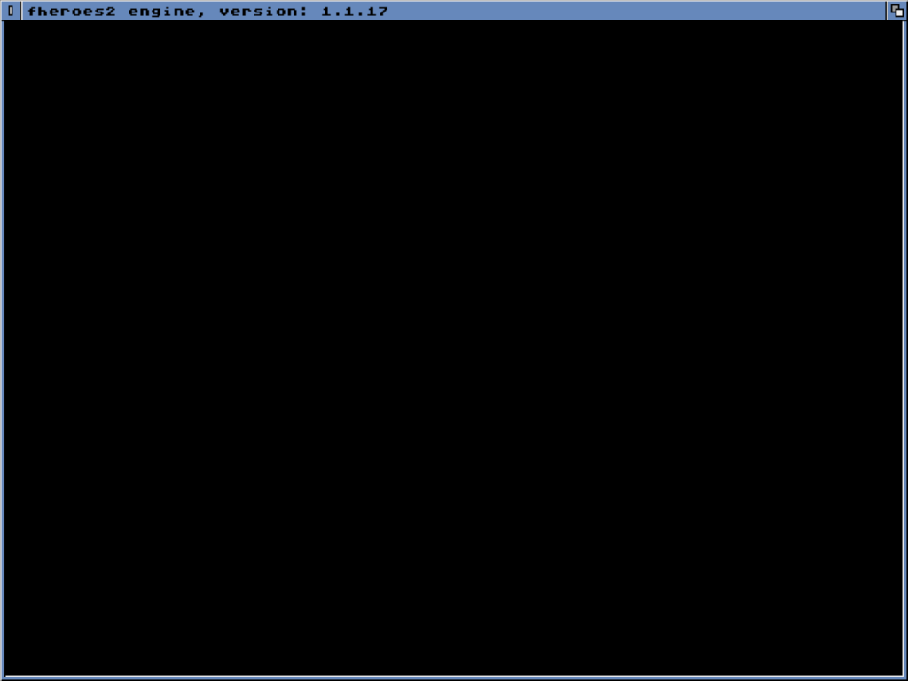

# fheroes2 on AROS m68k (FS-UAE), 30 October 2026

The scope: start-up, window, input and exit, **without game data**. This is
AROS m68k, not AmigaOS 3.2.3, and it is not a gameplay test.

## Setup

- The bench is the project's AROS FS-UAE bench (`tools/aros-fsuae-bench` in the project files).
- AROS nightly 20261030 amiga-m68k boot ISO (zip sha256
  `bec7d2dbb24defbc9cdade677d50c1f8bfe20bf949151d75a671433a4373a00f`), with AROS's own ROM and extension ROM.
- FS-UAE emulates an A1200 with a 68040, 64 MB motherboard RAM and a 4 MB UAEGFX Z2 card.
- No opengpu.library is installed, so SDL uses its software renderer.
- In `LIBS:`:
  - `OpenGPU/SDL2.module` (`caca3287…87c6`)
  - `OpenGPU/SDL2_mixer.module` (`69901471…a17`)
  - `z.library`: OpenZlib, amigachrome-guest `868271b`, built with the open3 SDK (`bc75f935…59c3`)
- `fheroes2` executable sha256 `6ee32bf8f4c16801c36c50501a891d941f264364aa70732fb15a1259206e145f`.
  Its folder holds `files/data/resurrection.h2d` and the empty `data/` and `maps/`.
- Started from `S:User-Startup` with `Stack 200000`.

## Observed

1. The game starts, creates `PROGDIR:User/` with `fheroes2.cfg` and `files/save`, and opens its 640x480 window,
   titled "fheroes2 engine, version: 1.1.17", at about frame 500.
   
2. With no Heroes II data it takes the engine's normal missing-data path: the missing-assets screen, waiting for a key.
   The screen is black because the game palette comes from the missing data.
3. A key at frame 4000 closes the window within the following 250-frame capture interval.
   The program ends through the engine's normal error exit and Wanderer is back.

Two start-up faults were found here and fixed in `patches/0001-amigaos3.patch`:

- **Abort before `main()`.** `std::random_device` throws `std::system_error`, because AmigaOS has no entropy device.
  The exception was unwound during static initialisation, which aborted ("Program aborted").
  The engine's RNG is now seeded from the clocks and the thread's stack address.
- **No window.** The engine asks only for an accelerated SDL renderer.
  Without opengpu.library there is none, so the display was dropped.
  It now falls back to SDL's software renderer.
  With OpenGPU installed, the accelerated renderer is used as before.

## Still open

- Every gameplay gate, with the demo or the player's own data. archive.org, which hosts the demo, is blocked from the cloud.
- Sound.
- AmigaOS 3.2.3.
- Speed.
